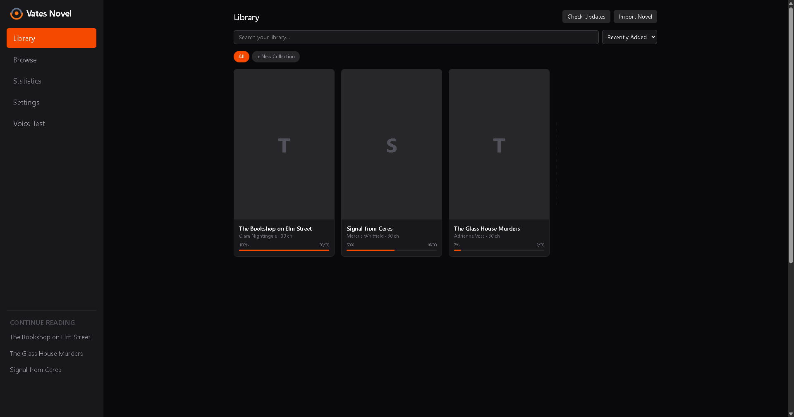
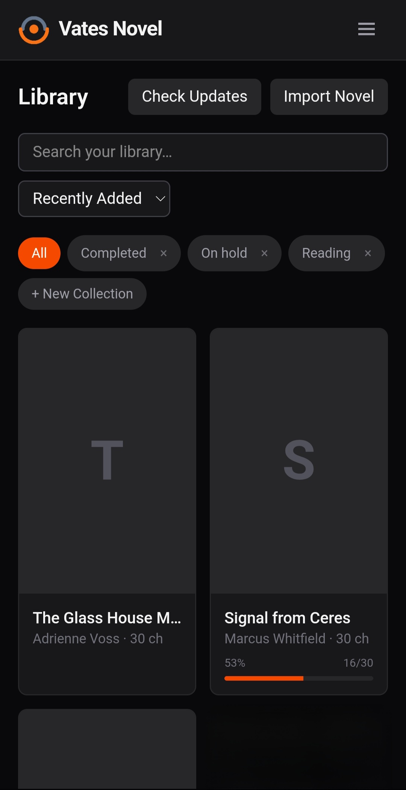
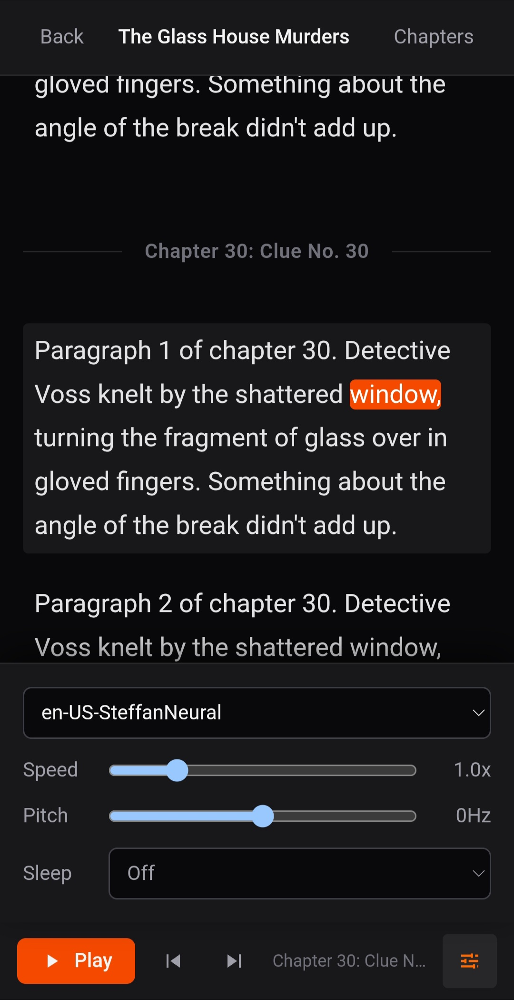
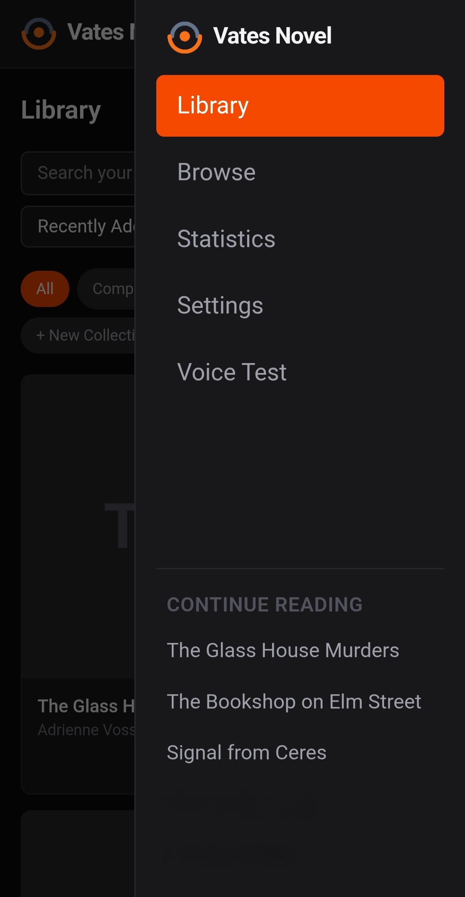
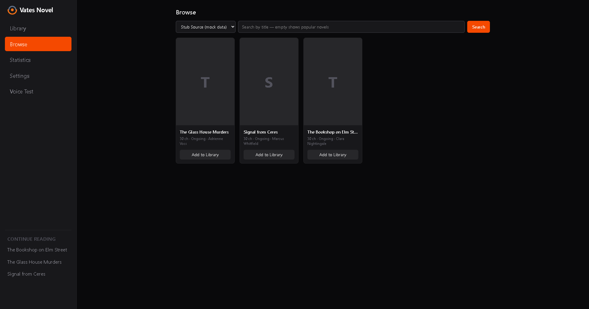
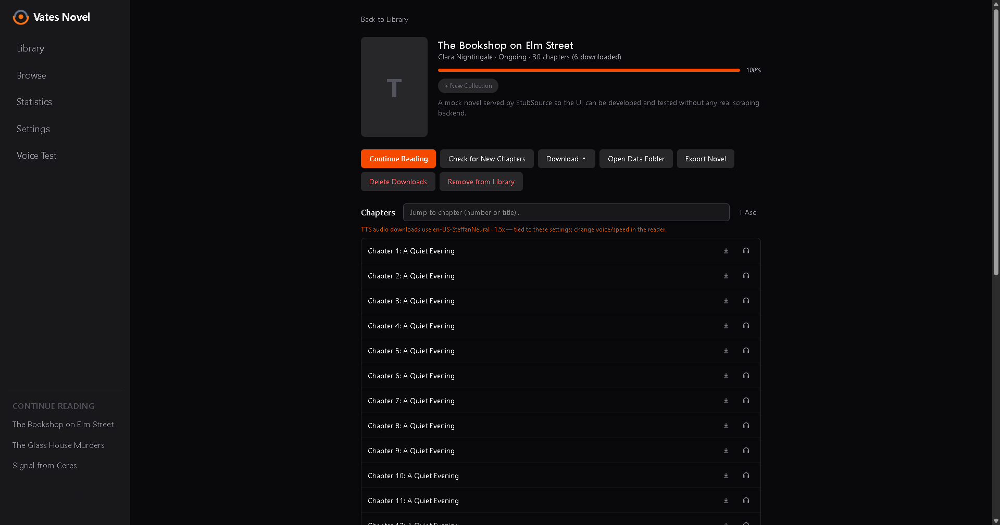
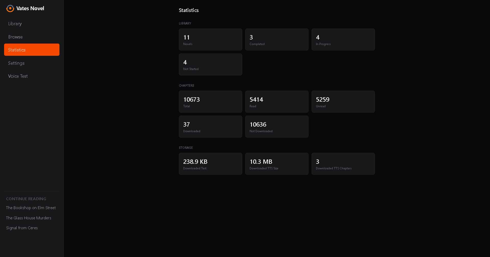
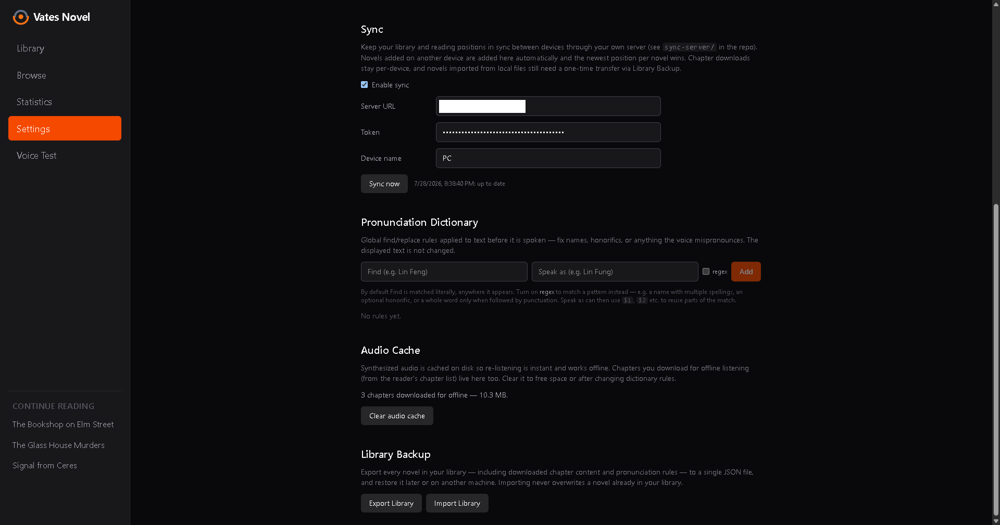

# Vates Novel

A web-novel reader for desktop (Windows/Linux/macOS) and Android, built from
one codebase with [Tauri v2](https://v2.tauri.app/), [React](https://reactjs.org/),
[TypeScript](https://www.typescriptlang.org/), and [Vite](https://vitejs.dev/).



## Features

- Library with collections, search, sorting, reading progress, and update
  checks manual or automatic on launch
- Browse and download novels from sources; download everything or just the
  next 25/50/100 chapters from your reading position, with retry/backoff
  (and a progress notification on Android)
- A reader that scrolls from one chapter straight into the next, tracks your
  exact position, and opens a slide-in chapter list for jumping around.
  Font, size, spacing, width and color are all adjustable
- Text-to-speech with word-level highlighting, from Edge voices online or the
  device's own voices offline (the Android TTS engine, or whatever the desktop
  provides). Edge audio is cached on disk for offline re-listening
- Chapter audio can be downloaded in advance: one chapter, or the next
  5/10/25/50/100 (or all) from where you are. A download keeps the voice, speed
  and pitch it started with, and carries on after you leave the reader
- Android: media notification with lock-screen controls, background playback
  and downloads with the screen off, slide-in navigation, hardware back support
- Import local `.epub`/`.pdf`/`.txt` files, export novels to EPUB/TXT, full library
  backup/restore as JSON
- Device sync: library and reading progress across devices via a self-hosted
  sync server (`sync-server/`)
- Pronunciation dictionary (global and per-novel find/replace before speech)
- Bookmarks, find in chapter (or across all downloaded chapters), and a
  draggable chapter progress %, each toggleable in Settings

## Screenshots

### Android

| Library | Reader, with the voice panel open | Navigation drawer |
| --- | --- | --- |
|  |  |  |

### Desktop

| Browse a source | A novel and its chapters |
| --- | --- |
|  |  |

| Statistics | Settings |
| --- | --- |
|  |  |

## Prerequisites

- [Node.js](https://nodejs.org/)
- [Rust](https://www.rust-lang.org/) and the Tauri prerequisites
  (see [Tauri documentation](https://v2.tauri.app/start/prerequisites/))

For Android builds additionally:

- Android Studio with the SDK and NDK (Side by side) installed
- JDK 17+ (Android Studio's bundled one works; `gradle.properties` pins its path)
- Rust Android targets:
  `rustup target add aarch64-linux-android armv7-linux-androideabi i686-linux-android x86_64-linux-android`
- `ANDROID_HOME` and `NDK_HOME` environment variables set

## Run

```bash
npm install

# Desktop (dev / release build)
npm run tauri dev
npm run tauri build

# Android (dev on a connected device or emulator / release build)
npm run tauri android dev
npm run tauri android build

# Live check that every novel source still works
npm run check-sources
```

Always build through the Tauri CLI. A plain `cargo build --release` produces a
binary that still expects the Vite dev server and fails with
"asset not found: index.html".

## Notes

- The Android project under `src-tauri/gen/android/` contains hand-maintained
  pieces (TLS init for the TTS websocket, system-TTS and notification bridges,
  foreground services) on top of the generated Tauri scaffolding.
- Android release APKs are signed with a local keystore:
  `src-tauri/gen/android/vates-novel-upload.jks` plus `keystore.properties`. 
  Without them the release build produces an unsigned APK that Android refuses to install.
